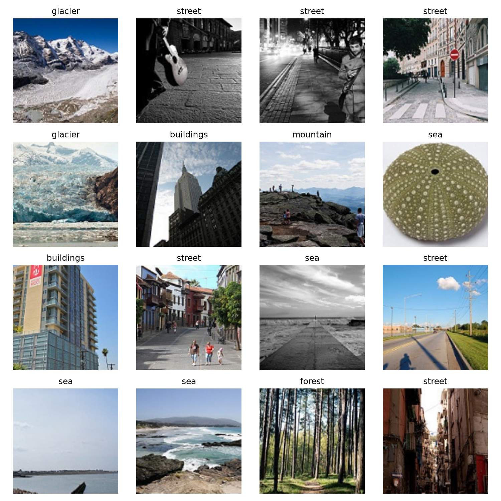

# ЛР3. Обчислювальний експеримент і трансферне навчання

**Результати роботи.** Виконано перевірки, сім основних запусків, вибір моделі за validation та тестову оцінку на CPU. Збережено `lab3_model.pt` для `unfreeze`, seed 3. Числа нижче взято з `checks/results.json`, журналів запусків та `analysis/results.json`; таблиці й рисунки аналізу також доступні в [автоматично сформованому звіті](analysis/report.md). Категорії п’яти помилок наведено за візуальним переглядом зображень; припущення про розмітку позначено окремо.

## Мета

Порівняти ResNet-18 у режимах `scratch`, `frozen` і `unfreeze` на вибірці з 200 навчальних зображень на клас. Окремо оцінити ефект попереднього навчання та ефект розморожування останнього блока, зіставити їх із розкидом між зернами за однакового бюджету у 304 кроки оптимізатора.

## Середовище та запуск

Команди виконуються з теки `lab3/`. Потрібні Python 3.12 та `uv`. Локальний інтерпретатор на момент підготовки звіту: Python 3.12.2. Точні версії залежностей зафіксовані в `uv.lock`; у `pyproject.toml` задані допустимі обмеження версій.

| Пакет | Версія в uv.lock |
| --- | --- |
| torch | 2.14.1 |
| torchvision | 0.29.1 |
| numpy | 2.5.4 |
| pandas | 3.1.0 |
| scikit-learn | 1.9.1 |
| matplotlib | 3.11.2 |
| pillow | 13.0.0 |

Встановлення за збереженим файлом залежностей:

```bash
uv sync --locked
```

`--locked` перевіряє актуальність `uv.lock`, не оновлюючи його при розбіжності з описом проєкту. Документація: [uv: locking and syncing](https://docs.astral.sh/uv/concepts/projects/sync/).

### Дані та шляхи

Використовується Intel Image Classification. `--data-dir` вказує на теку, що містить `seg_train` і `seg_test`. Функція `resolve_image_dir` підтримує обидва варіанти:

```text
dataset/                          dataset/
  seg_train/<клас>/*.jpg             seg_train/seg_train/<клас>/*.jpg
  seg_test/<клас>/*.jpg              seg_test/seg_test/<клас>/*.jpg
```

У командах нижче замініть `/path/to/dataset` на свій шлях. Якщо дані лежать у поточній теці `lab3/`, використовуйте `--data-dir .`. Тека `seg_pred` не використовується. Зображення відкриваються через Pillow з `convert("RGB")`; зображення меншого розміру не відкидаються. Сам набір зображень до репозиторію не додається.

### Навчання

Для перевірки вже збережених результатів достатньо команди **аналізу** нижче. Для нового навчання використовуйте окрему теку `reproduction`, щоб зберегти сім оригінальних журналів, за якими написано цей звіт:

```bash
uv run lab3_runs.py train --data-dir "/path/to/dataset" --output-dir reproduction
```

Команда створює `split.csv`, якщо його немає, виконує перевірки, сім запусків і зберігає журнали, логіти validation, ваги, підсумкову таблицю та криві. Після цього автоматично вибирає модель лише за validation та записує `lab3_model.pt` і `selection.json`; test у цій команді не завантажується. Наявний поділ у вибраній теці перевіряється. При першому досліді з BN у новій теці треба ввести прогноз перед дослідом; для відтворення цієї роботи його текст наведено в розділі 2 та в `checks/bn_prediction.txt`. Після введення він зберігається у `<output-dir>/checks/bn_prediction.txt` і повторно читається звідти.

Команда не перезаписує наявні каталоги запусків. `reproduction` — звичайна тека для окремої серії; її журнали не змішуються з оригінальними в `runs/`. Якщо вона вже містить запуски, для ще одного повтору задайте іншу нову теку. Нові значення можуть трохи відрізнятися від звіту, як дозволяє умова.

### Завершення вже виконаних семи запусків

`finalize` — допоміжна команда для попередньої серії, виконаної до додавання автоматичного збереження моделі. Для перевірки роботи після клонування репозиторію вона **не потрібна**: `lab3_model.pt` уже додано до матеріалів, а новий `train` зберігає вибрану модель автоматично. Допоміжна команда потребує локального `checkpoint.pt` вибраного запуску, який не входить до репозиторію.

Для цієї серії завершення вже виконано. Якщо потрібно знову сформувати фінальний файл зі збереженого checkpoint, повторне навчання не потрібне:

```bash
uv run lab3_runs.py finalize --output-dir .
```

`finalize` перевіряє сім журналів та їхні хеші, обирає режим за середнім validation macro-F1, потім найкраще зерно цього режиму. Вибраний `checkpoint.pt` вже містить словник `state_dict`, `regime`, `seed`, `classes`, `img_size`; його точна копія зберігається як `lab3_model.pt`. У цій серії вибрано `unfreeze`, seed 3. Файл `selection.json` зберігає вибір, хеш поділу та SHA-256 вибраних ваг. Він потрібен для перевірки моделі в аналізі й має зберігатися разом із нею.

Це одноразове завершення старої серії. Нові запуски `train` виконують цей крок автоматично. Окреме завантаження ваг у пам'ять виконується з `map_location="cpu"` і `weights_only=True`; використовується збережений `state_dict`. Джерело: [PyTorch: saving and loading models](https://docs.pytorch.org/tutorials/beginner/saving_loading_models.html).

### Аналіз

Щоб відтворити числа **цього звіту**, читайте збережену серію з поточної теки (`--output-dir .`). Її сім журналів, логіти та вибрана модель зберігаються в репозиторії; видаляти їх перед перевіркою не потрібно:

```bash
uv run lab3_analysis.py --data-dir "/path/to/dataset" --output-dir .
```

Команда перевіряє однаковість хешу `split.csv` у всіх семи журналах, наявність восьми епох, відповідність фінального F1 логітам validation та відповідність `lab3_model.pt` правилу вибору. Вона також звіряє хеш ваг із `selection.json` та, якщо локальна копія вибраного checkpoint ще є, із цією копією. Помилки перевірок зупиняють аналіз до читання test.

Далі відтворюються таблиця семи запусків і криві, а для єдиної вибраної моделі обчислюються логіти test **на CPU** у режимі `eval()` під `torch.inference_mode()`. Підсумкові значення виводяться в термінал і зберігаються:

```text
runs_summary.csv                  таблиця семи запусків
training_curves.png               дві панелі кривих
analysis/
  results.json                    статистика, ефекти, вибір, метрики test та помилки
  report.md                       таблиці й рисунки для звіту
  statistics.csv                  середні значення та розмах
  confusion_matrix.csv            матриця плутанини 6 × 6
  confusion_matrix.png            рисунок матриці
  five_errors.csv                 п'ять помилок та ймовірності прогнозів
  five_errors.png                 відповідні зображення
  test_logits.npy                 логіти test у порядку split.csv
  test_predictions.csv            файли, справжні класи, прогнози та ймовірності
```

Для окремого аналізу нової серії після її навчання вкажіть `--output-dir reproduction`; результати цього повтору не замінюють числа поточного звіту.

Копії `checkpoint.pt` інших запусків для аналізу не потрібні; обов'язкові журнали й логіти всіх семи запусків, `split.csv`, `lab3_model.pt` та `selection.json`. Тестові числа з `analysis/results.json`, матрицю та п’ять прикладів перенесено до розділу 5. Пояснення прикладів ґрунтуються на перегляді `analysis/five_errors.png`.

Для окремих етапів уже доступні:

```bash
uv run lab3_runs.py check --data-dir "/path/to/dataset" --output-dir .
uv run lab3_runs.py summary --output-dir .
```

`check` виконує лише перевірки. `summary` читає сім завершених запусків і повторно формує таблицю та криві без навчання; до появи всіх семи журналів вона завершиться помилкою.

## 1. Перевірки до навчання

### Поділ даних

Порядок класів та індексів: `buildings=0`, `forest=1`, `glacier=2`, `mountain=3`, `sea=4`, `street=5`.

Імена файлів у кожному класі сортуються як рядки. Один `np.random.default_rng(0)` послідовно перемішує індекси для всіх класів `seg_train`; перші 200 файлів кожного класу потрапляють до train. Новий генератор із зерном 0 використовується для `seg_test`: перші `n // 2` файлів стають validation, решта - test. Подальше завантаження відбувається за `split.csv` зі стовпцями `file`, `label`, `part`.

У кожній клітинці наведено **кількість / суму числових імен файлів**. Джерело результатів: [контрольна таблиця](checks/split_control.csv).

| Клас | train | validation | test | Збіг з умовою |
| --- | --- | --- | --- | --- |
| buildings | 200 / 1 996 761 | 218 / 4 837 323 | 219 / 4 837 559 | так, усі три |
| forest | 200 / 2 032 625 | 237 / 5 276 962 | 237 / 5 291 326 | так, усі три |
| glacier | 200 / 2 183 923 | 276 / 6 135 652 | 277 / 6 157 250 | так, усі три |
| mountain | 200 / 1 950 345 | 262 / 5 789 535 | 263 / 5 849 765 | так, усі три |
| sea | 200 / 1 987 613 | 255 / 5 655 068 | 255 / 5 668 011 | так, усі три |
| street | 200 / 1 841 817 | 250 / 5 541 845 | 251 / 5 547 533 | так, усі три |
| Разом | 1 200 / 11 993 084 | 1 498 / 33 236 385 | 1 502 / 33 351 444 | так |

Усі 18 клітинок збігаються з контрольними значеннями. У `split.csv` 4200 рядків і 4200 унікальних імен файлів: повторів та перетинів частин за іменем файлу немає.

SHA-256 поточного `split.csv`:

```text
148dad92de9a18670c177df9f8757aa6519fb0ea6d74a8ba723cfc4453f0a1bc
```

Після повторного формування поділу треба звірити цей хеш і результати перевірок. Якщо поділ змінився, усі сім основних запусків необхідно виконати заново.

### Пакет після перетворень

Навчальні перетворення: `RandomResizedCrop(160, scale=(0.7, 1.0))`, `RandomHorizontalFlip()`, `ToTensor()`, `Normalize`. Для validation і test: `Resize((160, 160))`, `ToTensor()`, `Normalize`.

Нормування в усіх режимах: `mean=(0.485, 0.456, 0.406)`, `std=(0.229, 0.224, 0.225)`. На рисунку перші 16 зображень одного навчального пакета після аугментацій, з оберненим нормуванням і підписами класів.



### Початкова втрата

Кожна перевірка виконана на новій моделі із зерном 1, на першому навчальному пакеті, після `set_train_mode`, під `torch.no_grad()` і до кроків оптимізатора. Орієнтир для рівномірних імовірностей: `ln(6) = 1.791759`.

| Режим | Зерно | Початкова втрата L₀ | L₀ − ln(6) |
| --- | --- | --- | --- |
| scratch | 1 | 2.047884 | +0.256125 |
| frozen | 1 | 1.924394 | +0.132635 |

В обох режимах втрата перевищила `ln(6)`. Випадково ініціалізований шар `fc` не зобов'язаний давати рівні логіти для всіх класів; нерівномірні прогнози можуть збільшити втрату. У `frozen` попередньо навчені ознаки поєднуються з новою випадковою головою на шість класів. Ці вимірювання на одному пакеті не є оцінкою переваги одного режиму над іншим.

Моделі після цієї перевірки не використовуються в основному експерименті: прямий прохід у режимі навчання може змінювати буфери BN навіть під `no_grad()`.

## 2. Перевірка режимів навчання

### Параметри та оптимізатор

Використовується ResNet-18 із головою `Linear(512, 6)`. Для `scratch` початкові ваги випадкові; для `frozen` та `unfreeze` - `ResNet18_Weights.IMAGENET1K_V1`. Зерна PyTorch і NumPy задаються до створення моделі. Кількість параметрів обчислюється як сума `numel()`.

| Режим | Усього параметрів | Навчаються | Групи AdamW: кількість і lr | Збіг |
| --- | --- | --- | --- | --- |
| scratch | 11 179 590 | 11 179 590 | усі: 11 179 590, lr=0.003 | так |
| frozen | 11 179 590 | 3 078 | fc: 3 078, lr=0.003 | так |
| unfreeze | 11 179 590 | 8 396 806 | fc: 3 078, lr=0.003; layer4: 8 393 728, lr=0.0003 | так |

Усі кількості й швидкості навчання збігаються з умовою. Перевірка підтвердила відсутність параметрів із `requires_grad=False` у групах оптимізатора. Для AdamW `weight_decay=1e-4`, решта аргументів стандартні. Для BN `momentum=0.1`, `eps=1e-5`.

### Зміни після п'яти кроків

Для кожної перевірки створено нову модель із зерном 1. До навчання скопійовано повний `state_dict`, включно з буферами BN. Після п'яти кроків на перших п'яти навчальних пакетах застосовано точне порівняння `torch.equal`. «Так» означає, що змінився хоча б один відповідний тензор модуля.

| Режим | Модуль | Параметри змінилися | Буфери BN змінилися | Збіг з очікуваним |
| --- | --- | --- | --- | --- |
| frozen | conv1 | ні | немає BN | так |
| frozen | bn1 | ні | ні | так |
| frozen | layer1 | ні | ні | так |
| frozen | layer2 | ні | ні | так |
| frozen | layer3 | ні | ні | так |
| frozen | layer4 | ні | ні | так |
| frozen | fc | так | немає BN | так |
| unfreeze | conv1 | ні | немає BN | так |
| unfreeze | bn1 | ні | ні | так |
| unfreeze | layer1 | ні | ні | так |
| unfreeze | layer2 | ні | ні | так |
| unfreeze | layer3 | ні | ні | так |
| unfreeze | layer4 | так | так | так |
| unfreeze | fc | так | немає BN | так |

Усі 14 перевірок збіглися з очікуваними. У `frozen` змінюється лише `fc`. У `unfreeze` змінюються параметри `layer4` і `fc`, а також буфери BN у `layer4`. Ці п'ять перевірочних кроків не входять до семи основних запусків.

### Дослід із навмисною помилкою BN

Для нової моделі `frozen` зі зерном 1 замість `set_train_mode` викликано звичайний `model.train()` і виконано п'ять кроків.

Прогноз, збережений перед дослідом у [bn_prediction.txt](checks/bn_prediction.txt):

> нові статистики порахуються за новими даними і train loss нічого не покаже, бо все одно буде навчатися голова і loss спадатиме

Виміряні зміни:

| Модуль | Параметри змінилися | Буфери BN змінилися |
| --- | --- | --- |
| conv1 | ні | немає BN |
| bn1 | ні | так |
| layer1 | ні | так |
| layer2 | ні | так |
| layer3 | ні | так |
| layer4 | ні | так |
| fc | так | немає BN |

Максимальні абсолютні зміни саме в `layer1.0.bn1`:

| Буфер | max(abs(після − до)) |
| --- | --- |
| running_mean | 0.092836380 |
| running_var | 0.120314360 |

Втрата на п’яти послідовних пакетах:

| Крок | Train loss до оновлення параметрів |
| --- | --- |
| 1 | 1.886960 |
| 2 | 1.945646 |
| 3 | 1.844244 |
| 4 | 1.683712 |
| 5 | 1.407404 |

Прогноз щодо оновлення статистик підтвердився. Ваги замороженої частини мережі не змінилися, але її буфери BN оновилися. Втрата зменшилась між першим і п'ятим пакетами, хоча на другому зросла: така поведінка сама по собі не дозволяє виявити неправильний режим BN.

`requires_grad=False` вимикає обчислення градієнтів для параметрів. `running_mean` і `running_var` є буферами, які BatchNorm оновлює під час прямого проходу в режимі навчання. Для заморожених модулів потрібен `eval()`. У режимі `unfreeze` блок `layer4` донавчається, тому оновлення його статистик відповідає протоколу. Документація: [PyTorch BatchNorm2d](https://docs.pytorch.org/docs/2.14/generated/torch.nn.BatchNorm2d.html).

## 3. Сім основних запусків

**Статус: усі сім запусків завершено.** У таблицю потрапляють тільки сім запусків нижче, після восьмої епохи; перевірочні моделі не враховуються.

Спільний бюджет: 8 епох × 38 кроків = 304 кроки оптимізатора. Train: `batch_size=32`, `shuffle=True`, `drop_last=False`, `num_workers=0`; останній пакет має 16 зображень. Validation і test: `batch_size=64`, `shuffle=False`, `num_workers=0`. Власного генератора чи sampler немає.

На кожній епосі використовується `set_train_mode`. Втрата - `CrossEntropyLoss` із середнім за пакетом; втрата епохи обчислюється як сума `batch_loss * batch_size`, поділена на 1200. Обчислення у `float32`, без змішаної точності, зміни швидкості навчання, обрізання градієнтів, ранньої зупинки чи вибору найкращої епохи.

Після кожної епохи обчислюється macro-F1 на всій validation: незважене середнє F1 шести класів, а не середнє метрик окремих пакетів. Документація: [scikit-learn f1_score](https://scikit-learn.org/stable/modules/generated/sklearn.metrics.f1_score.html).

Час у поточному коді - сума тривалостей восьми епох навчання разом із validation, без побудови моделі, запису журналів і ваг. Перед вимірюваннями та після них пристрій синхронізується.

| № | Режим | Зерно | Train loss, епоха 8 | Validation macro-F1, епоха 8 | Час, с |
| --- | --- | --- | --- | --- | --- |
| 1 | scratch | 1 | 1.007392 | 0.561898 | 198.652 |
| 2 | frozen | 1 | 0.165452 | 0.884201 | 95.563 |
| 3 | frozen | 2 | 0.175656 | 0.878500 | 96.773 |
| 4 | frozen | 3 | 0.189583 | 0.888596 | 95.874 |
| 5 | unfreeze | 1 | 0.080759 | 0.884312 | 112.123 |
| 6 | unfreeze | 2 | 0.095171 | 0.880918 | 112.234 |
| 7 | unfreeze | 3 | 0.081589 | 0.900652 | 112.359 |

Джерело чисел: `runs/<режим>_seed<зерно>/run.json`; зведена таблиця - `runs_summary.csv`. Журнал кожного основного запуску містить налаштування, зерно, версії, пристрій, Git-коміт і ознаку незакомічених змін, хеш `split.csv`, історію втрат і macro-F1, час. Поруч зберігаються `val_logits.npy` форми `1498 × 6` у порядку validation у CSV та локальний `checkpoint.pt` після восьмої епохи.


Підсумкові метрики беруться після восьмої епохи, навіть якщо в іншій епосі validation macro-F1 був вищим. Усі сім журналів містять епохи 1–8 та однаковий хеш поточного `split.csv`. Фінальні macro-F1 додатково перевірено за збереженими логітами validation; значення збігаються.

## 4. Розклад ефектів

Позначимо через $F_{r,s}$ macro-F1 на validation після восьмої епохи для режиму $r$ і зерна $s$. Для `frozen` та `unfreeze`:

$$
\overline F_r = \frac{1}{3}\sum_{s=1}^{3}F_{r,s},
\qquad R_r = \max_s F_{r,s} - \min_s F_{r,s}.
$$

$$
R = \max(R_{\mathrm{frozen}}, R_{\mathrm{unfreeze}}).
$$

$$
\Delta_{\mathrm{pre}} = \overline F_{\mathrm{frozen}} - F_{\mathrm{scratch},1},
\qquad
\Delta_{\mathrm{unf}} = \overline F_{\mathrm{unfreeze}} - \overline F_{\mathrm{frozen}}.
$$

$$
\Delta_{\mathrm{pre}} + \Delta_{\mathrm{unf}}
= \overline F_{\mathrm{unfreeze}} - F_{\mathrm{scratch},1}.
$$

Значення F1 наведені на шкалі 0–1. Для переведення різниці у відсоткові пункти використовується `100 * Δ`; це не відносний відсоток покращення.

| Величина | Значення |
| --- | --- |
| Середній F1 frozen | 0.883766 |
| Розмах frozen | 0.010095 |
| Середній F1 unfreeze | 0.888628 |
| Розмах unfreeze | 0.019734 |
| R | 0.019734 |
| Δpre | 0.321868 |
| Δunf | 0.004862 |
| Δpre + Δunf | 0.326730 |

Правило застосовується окремо до кожного ефекту. Якщо $|\Delta| \le R$, різниця не відрізняється від розкиду й результату за цим правилом немає. Якщо $|\Delta| > R$, ефект вартий подальшої перевірки, але не вважається доведеним. Поріг $R$ є грубою оцінкою шуму, а не довірчим інтервалом.

Зерно змінює випадкову ініціалізацію та послідовність випадкових операцій: перемішування і аугментації. У `scratch` випадково ініціалізується вся мережа; у `frozen` і `unfreeze` завантажуються ті самі ваги ImageNet, а нова голова випадкова. У `unfreeze` оновлюється більше параметрів і статистики BN у `layer4`, тому його чутливість до зерна може відрізнятися від `frozen`.

За результатами запусків:

- Ефект попереднього навчання: Δpre = 0.321868, або +32.187 в.п. Він більший за R = 0.019734. За правилом роботи ефект вартий подальшої перевірки; сам цей поріг не є статистичним доказом.
- Ефект розморожування: Δunf = 0.004862, або +0.486 в.п. Він менший за R = 0.019734 (1.973 в.п.). Різниця не відрізняється від розкиду, тому стійка перевага розморожування за цим протоколом не встановлена.
- Розмах `unfreeze` (0.019734) вищий за розмах `frozen` (0.010095) на цих трьох зернах.

R оцінено лише за `frozen` та `unfreeze`. Для `scratch` є один запуск, тож його розкид не виміряно і цей R не замінює таку оцінку. Крива `scratch` показує зниження train loss від 1.61768 до 1.00739 та коливання validation macro-F1; восьма епоха не демонструє переконливої стабілізації якості. Відставання в цьому експерименті велике, але його не слід переносити на будь-який бюджет: довше навчання могло б його зменшити.

| Режим | Середній час запуску, с |
| --- | --- |
| scratch, одне зерно | 198.652 |
| frozen, три зерна | 96.070 |
| unfreeze, три зерна | 112.239 |

За однакових 304 кроків фактичний час різний: `unfreeze` тривав приблизно на 16.8% довше за `frozen`, а `scratch` був найдовшим. Час включає validation, як зазначено в розділі 3.

## 5. Вибір моделі та тестова оцінка

### Правило вибору

За збереженими журналами найбільше середнє має `unfreeze` (0.888628), а його найкращий запуск - seed 3 із validation macro-F1 0.900652. Саме його вказує формальне правило. Вибір між `frozen` та `unfreeze` чутливий до шуму, оскільки Δunf < R. Фінальний файл `lab3_model.pt` уже збережено зі checkpoint цього запуску після восьмої епохи; аналіз підтвердив відповідність вибору та хешу ваг.

За умовою вибір відбувається у команді навчання лише за validation: спочатку режим із найбільшим середнім F1 (для `scratch` - його єдине значення), потім зерно з найбільшим F1 усередині цього режиму. Використовуються ваги після восьмої епохи. Якщо $|\Delta_{\mathrm{unf}}| \le R$, вибір між `frozen` та `unfreeze` потрібно описати як чутливий до шуму.

Для цієї серії виконано `finalize` і команду аналізу. Файл `lab3_model.pt` містить `state_dict`, `regime`, `seed`, `classes`, `img_size=160`. Після перевірки вибору та хешів test оцінено на CPU, на всіх 1502 зображеннях. Test не використовується для зміни конфігурації, зерна чи кількості епох; повторний аналіз для відтворення результатів дозволено.

| Показник | Значення |
| --- | --- |
| Вибраний режим | unfreeze |
| Вибране зерно | 3 |
| Validation macro-F1 вибраного запуску | 0.900652 |
| Test macro-F1 | 0.887931 |
| Test accuracy | 0.885486 (1330 / 1502) |
| Test macro-F1 − validation macro-F1 | -0.012721 (−1.272 в.п.) |
| Орієнтовна стандартна похибка accuracy | 0.008216 (0.822 в.п.) |

Оцінка порядку шуму для accuracy:

$$
\mathrm{SE}_{\mathrm{accuracy}} \approx \sqrt{\frac{p(1-p)}{1502}},
$$

де $p$ - частка правильних відповідей на test. Ця формула не є стандартною похибкою macro-F1. Вибір найкращого зерна робить його validation-оцінку оптимістичною; різницю з test може маскувати шум скінченних вибірок.

Test macro-F1 дорівнює 0.887931, тоді як validation macro-F1 вибраного запуску — 0.900652. Падіння на 0.012721, або 1.272 в.п., узгоджується з очікуваним оптимізмом вибору найкращого зерна за validation. Водночас однієї пари оцінок недостатньо, щоб відокремити цей ефект від шуму скінченних вибірок. SE accuracy = 0.008216 характеризує лише accuracy: її не можна використовувати як похибку різниці macro-F1 або підставу для висновку про статистичну значущість цього падіння. В іншому поділі випадково легша test-вибірка могла б дати F1 навіть вище за validation: коливання оцінок можуть перекрити очікуваний оптимізм вибору та змінити знак різниці.

### Матриця плутанини

Рядки — справжній клас за розміткою, стовпці — передбачений. Сума всіх клітинок — 1502, діагоналі — 1330; загалом 172 помилки.

| Справжній / передбачений | buildings | forest | glacier | mountain | sea | street |
| --- | --- | --- | --- | --- | --- | --- |
| buildings | 195 | 0 | 1 | 1 | 2 | 20 |
| forest | 0 | 233 | 1 | 0 | 1 | 2 |
| glacier | 1 | 0 | 195 | 72 | 9 | 0 |
| mountain | 1 | 0 | 19 | 238 | 5 | 0 |
| sea | 3 | 0 | 5 | 6 | 241 | 0 |
| street | 22 | 0 | 0 | 0 | 1 | 228 |


Найчастіша помилка — `glacier → mountain` (72), зворотний напрям має 19 випадків. Разом це 91 із 172 помилок. Друга помітна взаємна плутанина — `street ↔ buildings`: 22 + 20 = 42 випадки. Це узгоджується з візуальним перетином класів: засніжені гори та льодовики, вулиці та будівлі в одній сцені.

### П'ять характерних помилок

За протоколом беруться п'ять найчастіших позадіагональних пар із матриці. За рівної частоти - спочатку менший індекс справжнього, потім передбаченого класу. Для кожної пари береться перший файл за лексикографічним порядком імен. Якщо різних пар менше п'яти, додаються наступні файли пар у тому самому порядку частот. Ймовірність прогнозованого класу обчислюється через softmax логітів test.

| Файл | Справжній клас | Передбачений клас | Імовірність прогнозу | Кількість помилок цієї пари у test | Категорія та пояснення |
| --- | --- | --- | --- | --- | --- |
| 20179.jpg | glacier | mountain | 0.857014 | 72 | Неоднозначна сцена з ознаками обох класів: гірські схили та сніг/лід. За цим кадром важко чітко відокремити льодовик від засніжених гір; прогноз mountain візуально зрозумілий. |
| 20454.jpg | street | buildings | 0.763639 | 22 | Сцена містить обидва класи: дорогу між рядами будівель. Модель віднесла її до buildings, хоча мітка street описує всю сцену. |
| 20246.jpg | buildings | street | 0.999938 | 20 | Сцена містить обидва класи: великий фасад будівлі та вуличний простір перед ним. Висока ймовірність street не усуває неоднозначності між об’єктом і сценою. |
| 20320.jpg | mountain | glacier | 0.932026 | 19 | Неоднозначна сцена з ознаками обох класів: гірський масив зі снігом/льодом. Візуальна межа mountain/glacier нечітка; це приклад перетину класів набору. |
| 20383.jpg | glacier | sea | 0.788688 | 9 | Ймовірна помилка розмітки: видно червонуваті шаруваті скелі, схожі на каньйон, без очевидного льодовика. Мітка glacier сумнівна; прогноз sea також не відповідає видимій сцені. |


Ці категорії є візуальною інтерпретацією, а не перевіреною новою розміткою. Особливо для `glacier ↔ mountain` сама наявність снігу ще не доводить, що на фото льодовик; плутанину слід розглядати як властивість набору. Припущення щодо `20383.jpg` не використовувалося для зміни мітки чи перерахунку метрик. Висока ймовірність softmax, наприклад 0.999938 для `20246.jpg`, не гарантує правильності прогнозу.

## 6. Висновок

Попереднє навчання дало найбільший приріст за цього бюджету: середній macro-F1 `frozen` дорівнює 0.883766 проти 0.561898 у `scratch`. Ефект Δpre = +0.321868 (+32.187 в.п.) перевищує R = 0.019734. За правилом роботи це ефект, вартий подальшої перевірки; один запуск `scratch` не дозволяє оцінити його власний розкид.

Розморожування `layer4` збільшило середній macro-F1 до 0.888628, але Δunf = +0.004862 (+0.486 в.п.) менше за R. Отже, стійкої переваги `unfreeze` над `frozen` у цих запусках не встановлено. До того ж `unfreeze` мав більший розмах між зернами та займав у середньому 112.239 с проти 96.070 с у `frozen` — приблизно на 16.8% довше.

За формальним правилом вибрано `unfreeze`, seed 3. Його test macro-F1 на CPU — 0.887931, accuracy — 0.885486; test macro-F1 нижчий за validation на 1.272 в.п. Основна плутанина припадає на `glacier ↔ mountain` та `street ↔ buildings`; перегляд прикладів показує перетин класів і щонайменше одну підозрілу мітку.

Для подібної нової задачі з 200 зображеннями на клас я б починала з `frozen`: у цьому досліді він дає близьку якість, менший розкид і коротший час. `Unfreeze` варто перевіряти як наступний варіант за validation. Ця практична рекомендація не змінює вибраної для поточної роботи моделі. Обидва висновки про ефекти стосуються лише 304 кроків оптимізатора: за довшого навчання `scratch` міг би скоротити відставання.

## Відтворюваність і матеріали

Перевірки розділів 1–2 взято зі збереженого `checks/results.json`. Після повторного `check` або `train`, які оновлюють перевірки, ці таблиці треба звірити з новим журналом. Числові результати на MPS/GPU можуть трохи відрізнятися; контрольний поділ, конфігурація та відповіді «так / ні» мають відтворюватися.

До фінального репозиторію мають увійти `.py`-файли, `pyproject.toml`, `uv.lock`, `.python-version`, `split.csv`, результати перевірок, журнали та логіти validation всіх семи запусків, `lab3_model.pt`, `selection.json`, результати `analysis/`, рисунки й цей README. Ваги решти запусків зберігаються локально до вибору; набір зображень до репозиторію не додається.

Усі сім запусків виконано на **Apple M1 (mps)**, Python 3.12.2, PyTorch 2.14.1, torchvision 0.29.1, NumPy 2.5.4.

У журналах однаковий Git-коміт `8aacb8dfeac0a9ec0307da91d3ff93692938c6cd` і `dirty=true`: навчання виконано з незакоміченими файлами лабораторної. Це потрібно враховувати при відтворенні: сам коміт не описує весь код запуску. Хеші файлів однакові в усіх семи журналах. Вони описують версію, якою виконано навчання:

- `lab3_runs.py`: `25c3a4110ae7915962246ab9dcf8584ed5508a597c6e6ac74d82b092f8ec11ec`;
- `lab3.py`: `2fa6722bd835605354792e6bf2be87e41ecf20fcb13398783daad73ee2a9f233`.

Після навчання підготовлено патч завершення: спільні функції читання журналів і вибору винесено в `lab3_results.py`, у `lab3_runs.py` додано збереження моделі, а в `lab3_analysis.py` - перевірки й аналіз CPU. `lab3.py`, гіперпараметри та вже отримані журнали не змінювалися цим патчем. Хеш поточного `lab3_runs.py` тому відрізняється від хешу в старих журналах; збережені журнали навчання не змінювалися. Окремо після навчання в блоці прямого запуску `lab3.py` додано перевірку наявності `split.csv`, щоб не перезаписувати його, та прибрано коментарі. Це також змінює хеш файлу, але функції побудови моделей, поділу, навчання й перевірок залишилися тими самими; команда `lab3_runs.py` імпортує ці функції й не виконує цей блок.

Числа розділів 3–5 звірено з `analysis/results.json`: команда аналізу читає збережені журнали, повторює обчислення статистики й вибору та оцінює вибрану модель на test. Тестова оцінка виконана на CPU (Python 3.12.2, PyTorch 2.14.1). Хеші поточних файлів збігаються з записаними в результатах аналізу й `selection.json`:

- SHA-256 `lab3_model.pt`: `69a9ccfd37858d781041441eb6e2f8392db4728f4673a7c4d1aec6a9c5565592`;
- SHA-256 `split.csv`: `148dad92de9a18670c177df9f8757aa6519fb0ea6d74a8ba723cfc4453f0a1bc`.

Тестові прогнози містять 1502 рядки; macro-F1 та accuracy, повторно обчислені з матриці плутанини, збігаються зі звітом.

## Джерела та допоміжні інструменти

- Умова «ЛР3. Обчислювальний експеримент і трансферне навчання».
- Офіційна документація PyTorch, scikit-learn і uv наведена біля відповідних пояснень.
- ChatGPT/Codex використано для пояснення понять, налагодження, підготовки окремих фрагментів коду, патчів і цього README. Числа в таблицях взято з локальних перевірок, журналів семи запусків та виконаного аналізу test на CPU. Категорії помилок сформульовано з допомогою Codex після візуального перегляду зображень; припущення про мітки не змінювали тестових результатів.
