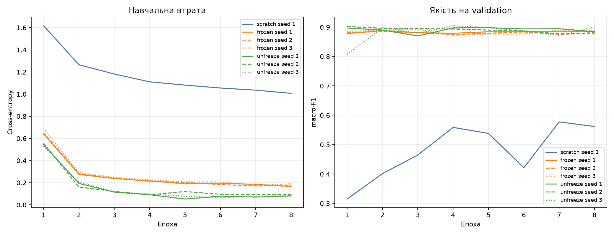
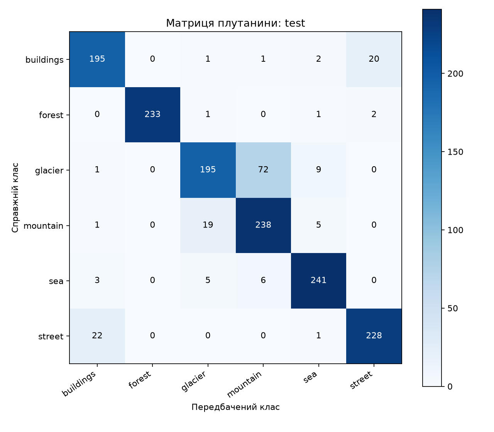
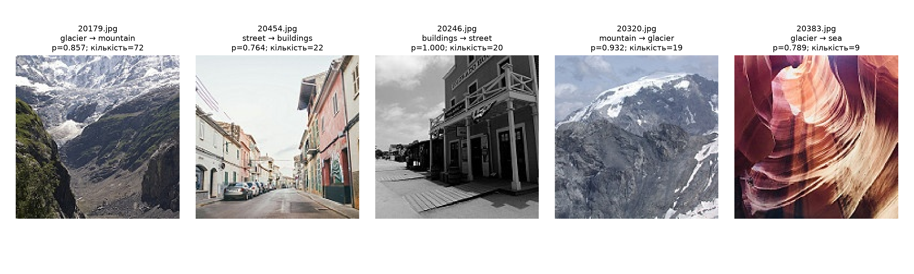

# Результати команди аналізу

## Сім запусків

| Режим | Зерно | Train loss, епоха 8 | Validation F1, епоха 8 | Час, с |
| --- | --- | --- | --- | --- |
| scratch | 1 | 1.007392 | 0.561898 | 198.652 |
| frozen | 1 | 0.165452 | 0.884201 | 95.563 |
| frozen | 2 | 0.175656 | 0.878500 | 96.773 |
| frozen | 3 | 0.189583 | 0.888596 | 95.874 |
| unfreeze | 1 | 0.080759 | 0.884312 | 112.123 |
| unfreeze | 2 | 0.095171 | 0.880918 | 112.234 |
| unfreeze | 3 | 0.081589 | 0.900652 | 112.359 |

## Середні значення та розмах

| Режим | Середній F1 | Розмах |
| --- | --- | --- |
| scratch | 0.561898 | не оцінено |
| frozen | 0.883766 | 0.010095 |
| unfreeze | 0.888628 | 0.019734 |

| Величина | Значення |
| --- | --- |
| R | 0.019734 |
| Δpre | +0.321868 |
| Δunf | +0.004862 |
| Δpre + Δunf | +0.326730 |

Δpre: ефект вартий перевірки, але не доведений.

Δunf: різниця не відрізняється від розкиду.

## Вибір та test на CPU

Вибрано **unfreeze, seed 3**, validation F1 = 0.900652.

| Метрика | Значення |
| --- | --- |
| macro_f1 | 0.887931 |
| accuracy | 0.885486 |
| num_images | 1502 |
| accuracy_standard_error | 0.008216 |
| test_minus_validation_f1 | -0.012721 |
| device | cpu |

## Матриця плутанини

| Справжній / прогноз | buildings | forest | glacier | mountain | sea | street |
| --- | --- | --- | --- | --- | --- | --- |
| buildings | 195 | 0 | 1 | 1 | 2 | 20 |
| forest | 0 | 233 | 1 | 0 | 1 | 2 |
| glacier | 1 | 0 | 195 | 72 | 9 | 0 |
| mountain | 1 | 0 | 19 | 238 | 5 | 0 |
| sea | 3 | 0 | 5 | 6 | 241 | 0 |
| street | 22 | 0 | 0 | 0 | 1 | 228 |

## Характерні помилки

| Файл | Справжній клас | Прогноз | Імовірність | Частота пари |
| --- | --- | --- | --- | --- |
| 20179.jpg | glacier | mountain | 0.857014 | 72 |
| 20454.jpg | street | buildings | 0.763639 | 22 |
| 20246.jpg | buildings | street | 0.999938 | 20 |
| 20320.jpg | mountain | glacier | 0.932026 | 19 |
| 20383.jpg | glacier | sea | 0.788688 | 9 |

Для кожного зображення додайте власне пояснення: обидва класи у сцені, ймовірна помилка розмітки або помилка моделі на однозначному зображенні.
